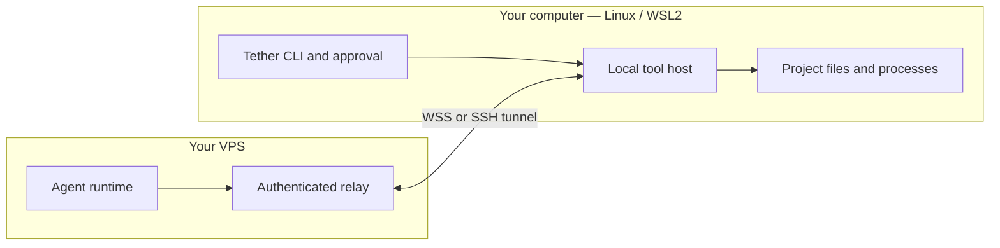

# Claude Tether

[](https://github.com/JackXing875/claude-tether/actions/workflows/ci.yml)
[](LICENSE)

Run the Claude Code agent on your VPS while keeping project tools and approval on your own computer.

[中文](README.zh-CN.md) · [Quick start](docs/QUICKSTART.md) · [Architecture](docs/ARCHITECTURE.md) · [Contributing](CONTRIBUTING.md)

**Development alpha.** The working end-to-end path currently uses an offline, deterministic agent. The candidate official CLI supervisor, MCP subprocess bridge and subscription probe exist, but official account behavior has not been verified; the public CLI still only enables the fake runtime. See the [release gates](docs/ROADMAP.md). This is an independent project, not affiliated with Anthropic.

## Try it in two minutes

Requirements: Linux or WSL2, Git, Node.js **24.14+ within 24.x**, npm, and `ripgrep` for file search. Use the version in [.nvmrc](.nvmrc) for a reproducible environment. Native Windows and macOS are not supported yet.

```bash
git clone https://github.com/JackXing875/claude-tether.git
cd claude-tether
npm ci
npm run demo
```

The demo creates a temporary project, reads a broken addition function, shows a diff, edits it, runs a real local test, and cleans up. It requires no VPS, Claude account, API key, or payment. Automatic approval applies only to this disposable project. Expect `演示验收通过` at the end. Node 24 may print its experimental SQLite warning.

After the demo, inspect the CLI:

```bash
node bin/tether.mjs --help
node bin/tether.mjs doctor
```

For separate server/client processes, SSH tunneling, or an installed `tether` command, follow the [quick start](docs/QUICKSTART.md). There is no npm registry release yet; do not assume `npx claude-tether` installs this repository.

## How it works



The project directory remains on the client. Prompts, requested file content and tool results travel through the VPS and model service. Commands run with the local user's privileges after local approval; a working directory is **not an OS sandbox**.

- Device credentials, verified TLS, explicit workspace/session binding, and revocation.
- Local UTF-8 read/search/edit/create tools with revision checks and diff approval.
- Foreground commands with argv arrays, bounded output, timeout and process-group cancellation.
- Durable operation receipts, duplicate suppression, explicit reconnect and event replay.
- Crash outcomes marked `UNKNOWN` block further mutations until inspected.
- Typed core modules, source-inclusive tarballs, architecture checks, automated tests and install smoke tests.

Current limits include one active turn per relay, Linux/WSL only, 128 KiB files, 60-second commands, and no background jobs, PTY, automatic reconnect, full TUI, hooks/skills or IDE integration. [Compatibility](docs/COMPATIBILITY.md) records the exact boundary.

## Develop

```bash
# Tests also need openssl; on Ubuntu/WSL: sudo apt-get install ripgrep openssl
npm ci
npm run verify
npm run test:coverage
npm run test:package
```

CI runs the supported Node 24 minimum and current 24.x on Ubuntu, checks formatting/types/lint/module boundaries/docs, exercises real local processes and WebSockets, and installs the packaged CLI outside the checkout. No Claude credentials are needed in CI. [Testing details](docs/TESTING.md).

Read [CONTRIBUTING.md](CONTRIBUTING.md) before changing permissions, state or protocol behavior. Report vulnerabilities through [SECURITY.md](SECURITY.md). The implementation is licensed under [GPL-3.0](LICENSE); `private: true` prevents accidental npm publication, not source use. Official Claude software and account credentials are not bundled.
