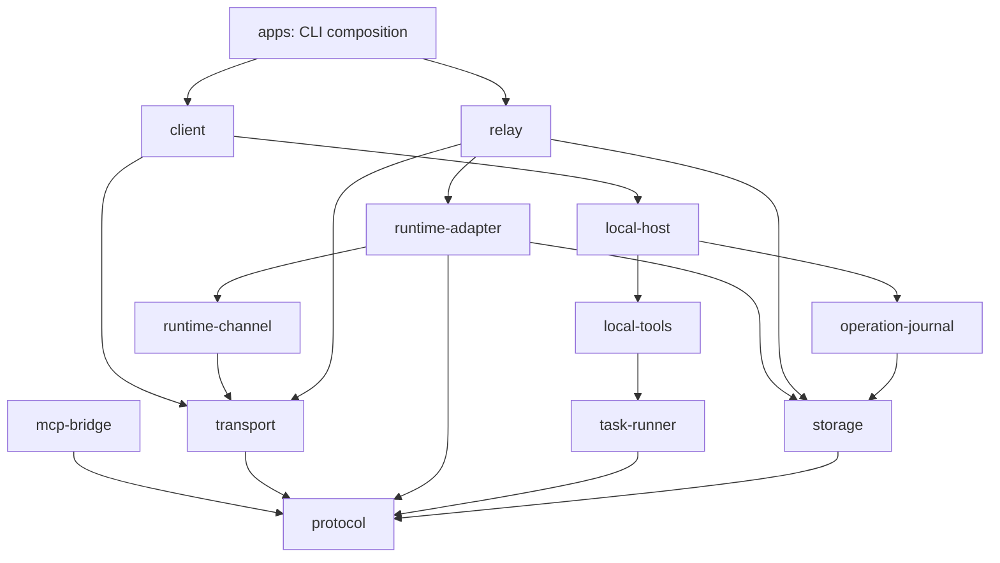

# Architecture

Tether separates an agent's location from the location of its tools. A relay owns authentication, session sequencing and event delivery. The local host owns workspace identity, approval and execution. The current runnable agent is `FakeAgent`; the official Claude adapter is isolated behind a compatibility gate.

## Module boundaries

| Module                          | Responsibility                                                                            |
| ------------------------------- | ----------------------------------------------------------------------------------------- |
| `protocol`                      | Versioned Zod schemas, binding checks, limits, result/error types                         |
| `transport`                     | Bounded JSON-RPC over WebSocket; no permission policy                                     |
| `relay`                         | Device authentication, session ownership, one active turn, durable dispatch/event records |
| `runtime-adapter`               | Replaceable `AgentRuntime`; isolated official CLI launch and NDJSON decoding              |
| `mcp-bridge`                    | MCP tool registration and mapping to an injected local executor                           |
| `client`                        | Authenticated connection, explicit resume, event acknowledgement and turn API             |
| `local-host`                    | Final authorization, bound operations, serialized execution and cancellation              |
| `local-tools` / `task-runner`   | File contracts and local foreground processes                                             |
| `operation-journal` / `storage` | Durable receipts, event inbox, SQLite transactions and process lease                      |
| `config` / `diagnostics`        | Private local configuration and safe terminal rendering                                   |
| `apps` / `bin`                  | Argument parsing, lifecycle and terminal UX; no core module imports applications          |

`npm run check:architecture` parses imports, enforces this dependency graph and rejects cycles and core-to-app dependencies. SQLite tables are private to their owning stores. Public imports are limited by package `exports`: `claude-tether/client`, `/relay`, `/local-host`, `/protocol`, `/mcp-bridge`, `/runtime`. Their types ship with the tarball. APIs and storage formats are pre-1.0 and can change; migrations require explicit release notes.

Compatibility re-exports under the original `apps` locations preserve checkout imports during the refactor. New code uses `packages`; applications own startup and have no public library entrypoint. Importing public modules opens no socket or state database.

`BridgeClient.waitTurn(turnId, timeoutMs)` observes a terminal event; it does not submit or cancel a turn. Multiple callers can observe the same turn with independent deadlines. Timeout reports `TURN_TIMEOUT` without establishing the remote outcome; callers can wait again or explicitly resume after disconnect. Deadlines must be integer milliseconds in the range 1–2147483647 (default 120000); up to 64 pending observers are allowed per client. `close()` immediately rejects all pending observers with `WORKSPACE_OFFLINE` and is safe to repeat. The application still owns and must close its `LocalHost`. Already retained terminal events remain readable after closing the connection.

`BridgeClient.listSessions(options)` opens a short authenticated connection without a `LocalHost` or any tool handler. The additive `session.list` RPC filters the authenticated device and every workspace identity field, returning at most 128 metadata records in reverse creation order. It reads existing session/turn/dispatch tables; it neither claims ownership nor increments the worker epoch. The CLI reads the same private, validated `workspace.json` as `connect`, without opening the operation journal or creating missing state. Actual resume retains all original ownership, binding and reconciliation checks.

## A tool call

1. The relay binds a turn to device, workspace generation, execution target, policy revision and worker epoch.
2. Before dispatch, it persists the operation ID and request.
3. The local host validates the binding and input digest and persists acceptance. An existing operation ID reuses only its matching durable result.
4. For a mutation, the host prepares a preview and asks locally. Timeout, disconnect, cancellation or denial prevents execution.
5. A file operation checks its expected revision again immediately before committing. Commands use a program plus argv, with no implicit shell.
6. The host stores the result before replying. A missing network reply is reconciled from that receipt, not by replaying the side effect.
7. The client records events and their cursor before rendering. Resume explicitly names the original session and increments the worker epoch.

A crash after an effect but before its receipt is durable cannot be called exactly-once execution. It becomes `UNKNOWN` and blocks further mutations. Retained events are bounded; expired cursors report an error. State is intentionally not evicted to make unknown outcomes disappear.

## Trust and lifecycle

The relay can see transmitted project content, but cannot authorize local operations. A malicious program approved by the user still has the user's local privileges; cwd confinement is not a process sandbox. File tools reject symlinks, but do not claim protection against an arbitrary hostile process running as the same local user.

One SQLite lease prevents two processes from owning the same state. SIGINT/SIGTERM stop a foreground relay; disconnect cancels local tasks. Client and tool host currently share a process. A daemon, persistent UI attachment, full TUI and Windows Job Objects require separate lifecycle designs.

The official CLI is neither patched nor bundled. Its candidate launch uses a fixed version, explicit bridge tools, strict MCP configuration, explicit session UUIDs and a restricted environment. `--bare` is not used because the planned login is personal Pro/Max. The supervisor-to-MCP bridge now has synthetic subprocess evidence. Real subscription evidence remains a gate in [ROADMAP.md](ROADMAP.md); the public CLI does not enable Claude or silently fall back to fake.

## Candidate runtime lifecycle

`ClaudeRuntime` is exported from `claude-tether/runtime` for integration work. The public `--runtime claude` entrypoint supplies an absolute installed MCP worker entrypoint, a dedicated infrastructure state directory and the official executable. It verifies the subscription auth method and pinned CLI version, starts each turn in an isolated process group, and connects a real MCP stdio worker to an authenticated numeric-loopback channel. The capability JSON lives in a private per-turn directory and is removed at teardown; it is never placed in argv as a token.

Every channel call carries the complete binding and turn ID. Calls are blocked until the official-style initialization names the expected runtime session and complete local tool set. A channel accepts one connection and does not reconnect/replay lost calls. Dropping an in-flight call cancels its local work. Shutdown reaps the CLI/MCP process group, cancels local tasks, drains dispatches, closes the channel and removes ephemeral files.

A separate private SQLite store maps a bridge session to an explicit runtime UUID. Successful next turns use `--resume UUID`; no `--continue` inference is used. After an interrupted turn, an increased worker epoch from explicit bridge reconnect is required. Unconfirmed initialization remains blocked for inspection because a transcript may already exist. The relay's operation reconciliation runs before this runtime resume.

The synthetic test CLI returns a deliberately fake auth summary, then uses the actual MCP SDK and worker subprocess. Those tests prove transport/lifecycle behavior, not Anthropic authentication, entitlement, model behavior or current CLI flags. The official 2.1.267 path subsequently passed the [live acceptance](LIVE-TEST-REPORT.md); `tether server --runtime claude` now exposes it explicitly. Offline CI still uses the synthetic fixture.

The separate P0 compatibility probe uses a per-run random MCP challenge. `ProbeTurnEvidence` checks the requested runtime UUID and single-tool initialization on each turn, accumulates fragmented marker text with bounded memory, and rejects any tool call during recall. Before resume, the tool challenge changes while the prompt omits the previous marker. The CLI owns cancellation and temporary-directory cleanup; a successful subprocess exit alone never satisfies the resume gate.

## Managed SSH transport

`connect` and `sessions` can use `--ssh <config-alias>` instead of a direct URL. The application starts a private numeric-loopback listener and uses OpenSSH `-W` for each byte stream, with strict host verification and key/agent-only authentication. No remote shell command is constructed and no private key is copied. Socket shutdown terminates and reaps the owned SSH child. The existing device credential still authenticates every relay connection.

Private client state uses the stable SSH alias/remote relay port as its connection identity, never the ephemeral local port. Keep the alias, remote relay port, device, workspace and policy unchanged for session discovery/resume. Changing the alias is an explicit new connection identity. A missing workspace identity still returns an empty session list without opening SSH. Direct WSS/URL behavior remains available.
