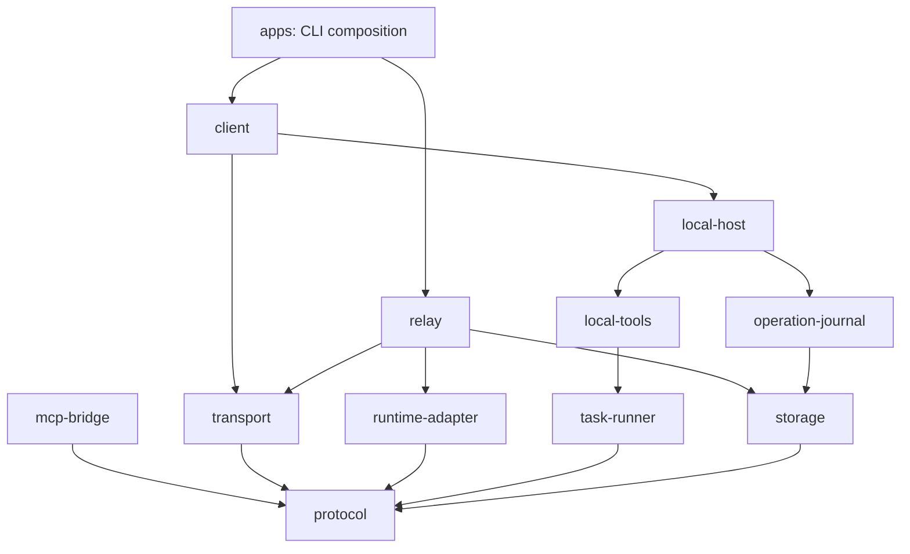

# Architecture

Tether separates an agent's location from the location of its tools. A relay owns authentication, session sequencing and event delivery. The local host owns workspace identity, approval and execution. The current runnable agent is `FakeAgent`; the official Claude adapter is isolated behind a compatibility gate.

## Module boundaries

| Module                          | Responsibility                                                                            |
| ------------------------------- | ----------------------------------------------------------------------------------------- |
| `protocol`                      | Versioned Zod schemas, binding checks, limits, result/error types                         |
| `transport`                     | Bounded JSON-RPC over WebSocket; no permission policy                                     |
| `relay`                         | Device authentication, session ownership, one active turn, durable dispatch/event records |
| `runtime-adapter`               | Replaceable `AgentRuntime`; isolated official CLI launch and NDJSON decoding              |
| `mcp-bridge`                    | MCP tool registration and mapping to an injected local executor                           |
| `client`                        | Authenticated connection, explicit resume, event acknowledgement and turn API             |
| `local-host`                    | Final authorization, bound operations, serialized execution and cancellation              |
| `local-tools` / `task-runner`   | File contracts and local foreground processes                                             |
| `operation-journal` / `storage` | Durable receipts, event inbox, SQLite transactions and process lease                      |
| `config` / `diagnostics`        | Private local configuration and safe terminal rendering                                   |
| `apps` / `bin`                  | Argument parsing, lifecycle and terminal UX; no core module imports applications          |

`npm run check:architecture` parses imports, enforces this dependency graph and rejects cycles and core-to-app dependencies. SQLite tables are private to their owning stores. Public imports are limited by package `exports`: `claude-tether/client`, `/relay`, `/local-host`, `/protocol`, `/mcp-bridge`, `/runtime`. Their types ship with the tarball. APIs and storage formats are pre-1.0 and can change; migrations require explicit release notes.

Compatibility re-exports under the original `apps` locations preserve checkout imports during the refactor. New code uses `packages`; applications own startup and have no public library entrypoint. Importing public modules opens no socket or state database.

## A tool call

1. The relay binds a turn to device, workspace generation, execution target, policy revision and worker epoch.
2. Before dispatch, it persists the operation ID and request.
3. The local host validates the binding and input digest and persists acceptance. An existing operation ID reuses only its matching durable result.
4. For a mutation, the host prepares a preview and asks locally. Timeout, disconnect, cancellation or denial prevents execution.
5. A file operation checks its expected revision again immediately before committing. Commands use a program plus argv, with no implicit shell.
6. The host stores the result before replying. A missing network reply is reconciled from that receipt, not by replaying the side effect.
7. The client records events and their cursor before rendering. Resume explicitly names the original session and increments the worker epoch.

A crash after an effect but before its receipt is durable cannot be called exactly-once execution. It becomes `UNKNOWN` and blocks further mutations. Retained events are bounded; expired cursors report an error. State is intentionally not evicted to make unknown outcomes disappear.

## Trust and lifecycle

The relay can see transmitted project content, but cannot authorize local operations. A malicious program approved by the user still has the user's local privileges; cwd confinement is not a process sandbox. File tools reject symlinks, but do not claim protection against an arbitrary hostile process running as the same local user.

One SQLite lease prevents two processes from owning the same state. SIGINT/SIGTERM stop a foreground relay; disconnect cancels local tasks. Client and tool host currently share a process. A daemon, persistent UI attachment, full TUI and Windows Job Objects require separate lifecycle designs.

The official CLI is neither patched nor bundled. Its candidate launch uses a fixed version, explicit bridge tools, strict MCP configuration, explicit session UUIDs and a restricted environment. `--bare` is not used because the planned login is personal Pro/Max. The missing supervisor-to-MCP IPC and actual subscription evidence are tracked in [ROADMAP.md](ROADMAP.md), not hidden behind an implicit fallback to the fake agent.
