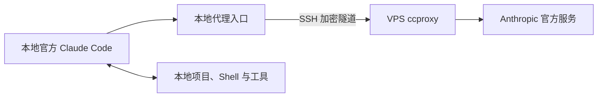

# 本地官方 Claude Code 经 VPS 出站：ccproxy 调研

调研日期：2026-10-23。范围：官方文档与固定版本源码阅读；尚未安装 ccproxy，也未实测本文的新链路。

用户最新需求是：账号持续可用性是首要目标，同时在本地项目中打开官方 `claude`，使用原生工具、聊天和 `/model`，让请求经过自己的 VPS。用户已提出优先采用 ccproxy，而不是先实施普通 CONNECT 代理。当前[产品定位](PRODUCT.md)已将目标主 Agent 放回本地；原 H1“主进程必须在 VPS”仅说明已实现原型。本文不把用户期望的“万无一失”当作已被证明的能力，也不把旧原型的验收结果当作新方案已通过验收。

## 结论与架构

原生本地体验可以通过请求层转发实现。依据用户最新选择，优先验证**本地官方 Claude Code + SSH 隧道 + VPS ccproxy**。最初提出的 CONNECT 代理保留为比较基线。采用 ccproxy 的工程偏好已记录；“ccproxy 比普通代理更不容易封号”仍缺少可验证证据，不能用这条假设代替测试。

这条候选路线中，Agent 循环、界面、文件操作和工具权限都由本地官方 CLI 负责。ccproxy 在 VPS 上处理应用层请求并建立上游连接，能够接触请求内容及其中的认证头；它与不解密 TLS 内容的 CONNECT 代理有不同的信任边界。拟仅绑定 VPS 回环地址，通过 SSH 访问；具体配置尚未部署。

| 路线                        | Agent 在哪里 | 本地交互与工具              | VPS 职责                   |
| --------------------------- | ------------ | --------------------------- | -------------------------- |
| 已实现的 Tether             | VPS          | 自建 REPL 与有限 MCP 工具桥 | 托管 Agent、会话和工具调度 |
| CONNECT 比较基线            | 本地         | 官方 CLI 自己提供           | 转发网络连接               |
| 用户优先选择的 ccproxy 网关 | 本地         | 官方 CLI；兼容性受网关影响  | 转发、路由或转换模型请求   |

当前 Tether 的限制来自架构与已实现范围：客户端只处理 `/help`、`/quit`，其他斜杠命令会被拒绝；远端以 `-p` 模式启动，并禁用内建工具，仅开放 MCP 桥。单独补上 `/model` 不会恢复官方 TUI、hooks、skills 和全部工具语义。见 [客户端入口](../apps/bridge-cli/main.ts)及[运行时启动参数](../packages/runtime-adapter/claude.ts)。

## ccproxy 项目辨识与源码观察

存在多个同名项目，不能混用它们的安装命令和能力说明。本轮重点阅读 `starbaser/ccproxy`，并核对了两个相关项目。

### starbaser/ccproxy

阅读快照：默认 `dev` 分支提交 `f2c47695b0835da023257aee0ac2a3dffd9fe570`，源码标记版本 2.0.0。GitHub 的 `releases/latest` 当时返回 v1.2.0；这与开发分支不是同一实现，不能将旧版 LiteLLM 教程直接用于开发版。

已核对的行为：

- 普通 `ccproxy run` 设置 `ANTHROPIC_BASE_URL` 等变量，再启动用户指定的本地命令。因此可以运行本地官方 `claude`，无需换成独立聊天界面。另有 `--capture` 网络命名空间模式。[启动源码](https://github.com/starbaser/ccproxy/blob/f2c47695b0835da023257aee0ac2a3dffd9fe570/src/ccproxy/cli.py#L426)
- 开发版使用 mitmproxy，并提供请求路由、格式转换和流量检查。模板还启用请求 shaping；相应 hook 在满足条件时从保存的请求模板重建出站请求。这比字节级 CONNECT 转发承担更多协议维护责任。[架构说明](https://github.com/starbaser/ccproxy/blob/f2c47695b0835da023257aee0ac2a3dffd9fe570/README.md)、[shaping 源码](https://github.com/starbaser/ccproxy/blob/f2c47695b0835da023257aee0ac2a3dffd9fe570/src/ccproxy/hooks/shape.py)
- 提供读取 Claude CLI 凭据文件、刷新 OAuth 和替换入站认证的功能。源码中的认证注入 hook 在没有特殊占位凭据时直接返回；不能因此推导整个网关都原样透传。是否托管凭据、是否路由和改写，是不同配置问题。[配置模板](https://github.com/starbaser/ccproxy/blob/f2c47695b0835da023257aee0ac2a3dffd9fe570/src/ccproxy/templates/ccproxy.yaml)、[认证注入源码](https://github.com/starbaser/ccproxy/blob/f2c47695b0835da023257aee0ac2a3dffd9fe570/src/ccproxy/hooks/inject_auth.py#L55)
- v1.2.0 则以 LiteLLM hooks 和规则路由为核心，规则可能改写客户端选择的模型。因此“界面能运行 `/model`”与“上游实际执行该模型”必须分别验证。[v1.2.0 README](https://github.com/starbaser/ccproxy/blob/v1.2.0/README.md)、[版本发布页](https://github.com/starbaser/ccproxy/releases/tag/v1.2.0)

初轮判断是：仅固定 VPS 出口无需引入整套组件。用户随后提出优先使用 ccproxy，因此下一阶段以其为候选验证；增加组件并不是降低封号率的证据。上述兼容性判断来自静态阅读，没有在我们的 Claude Code 2.1.267 上跑过该网关。

### CaddyGlow/ccproxy-api 与其他同名项目

`CaddyGlow/ccproxy-api` 阅读快照为 `8350f0d53ff4d909f24aa666aca38873ee7294e0`。它明确区分：

- `claude_api`：HTTP API 适配器，包含 OAuth 注入和可配置的 system prompt 处理。
- `claude_sdk`：通过服务端 Claude Code SDK/CLI 执行，带会话管理。

这两条路径不能视作等价。若研究本地官方 CLI 的模型网关，应研究 HTTP 路径；不能把 SDK 执行整项任务的输出直接当作一次模型 API 响应，否则可能出现两层 Agent 循环。见 [API 适配器源码](https://github.com/CaddyGlow/ccproxy-api/blob/8350f0d53ff4d909f24aa666aca38873ee7294e0/ccproxy/plugins/claude_api/adapter.py)、[SDK 插件说明](https://github.com/CaddyGlow/ccproxy-api/blob/8350f0d53ff4d909f24aa666aca38873ee7294e0/ccproxy/plugins/claude_sdk/README.md)。

另一个 `orchestre-dev/ccproxy` 已在 README 中明确归档，不作为新实现的首选依据。[项目状态](https://github.com/orchestre-dev/ccproxy)

## 官方支持的连接方式与 Pro 登录

官方 CLI 支持 `HTTPS_PROXY`、`HTTP_PROXY`、`NO_PROXY`，明确不支持直接使用 SOCKS 代理。因此只运行 `ssh -D` 并填写 `socks5://...` 不是这里的配置方案；应提供兼容的 HTTP 代理入口。变量须在启动 CLI 前生效，并核对已有大小写代理变量与绕过规则。[官方网络配置](https://code.claude.com/docs/en/network-config)

Pro/Max 用户可以在本地官方 CLI 通过 `claude auth login` 正常登录。此前完成的是 VPS 上的登录，本地实例不会自动拥有这份状态；采用新路线时需要确认本地登录，必要时由用户在本地完成一次官方授权，无需把 VPS token 复制出来。[官方认证文档](https://code.claude.com/docs/en/authentication)

网络代理与 `ANTHROPIC_BASE_URL` 网关要区分。官方文档明确：仅更改 base URL 不等于替换订阅认证，但配置替代网关凭据或 `apiKeyHelper` 会改变所用认证来源。因此不应为“使用代理”随意填入 API Key 或占位认证变量。[网关与订阅](https://code.claude.com/docs/en/llm-gateway#subscriptions-and-gateways)

`/model` 是官方 CLI 自身的功能；代理不增加账号的模型权限或额度。HTTP 网关还必须正确传递流式事件、请求字段和能力头；部分辅助请求不跟随 `ANTHROPIC_BASE_URL`，因此不能仅凭模型请求成功就声称全部网络流量经过 VPS。[模型配置](https://code.claude.com/docs/en/model-config#setting-your-model)、[网关兼容性](https://code.claude.com/docs/en/llm-gateway-protocol)

上述为调研时的在线文档。当前项目固定 CLI 为 2.1.267，后续验证需记录实际本地版本；不把新文档中后来增加的功能默认归入该版本。

## 账号持续可用性与本机信息：补充核对

用户强调“避免被 Claude 封号”是贯彻始终的首要诉求。后续方案应优先讨论账号、认证和异常请求风险，其次是原生体验，再次是实现成本；不能只用“更简单”解释选型。但没有可验证的零封号保证，也没有查到能够比较本项目两种代理路线封号率的可信数据。

已核对的具体边界：

| 问题                             | 证据与结论                                                                                                                                                                    |
| -------------------------------- | ----------------------------------------------------------------------------------------------------------------------------------------------------------------------------- |
| ccproxy 是否自动隐藏本机信息     | 模板将 `messages`、`system`、`metadata` 列为从客户端填入的内容；`inject_content` 会复制这些字段，system 的默认策略是拼接而非全面替换。它不是本机信息的通用脱敏器。            |
| 请求 shaping 是否总会运行        | `shape()` 在请求与模板的 User-Agent 属于同一系列时直接返回；还取决于路由、变换记录与模板是否存在。启用 shaping 不等于每个请求都被重建。                                       |
| 会话提取是否清除客户端标识       | `extract_session_id` 只将解析结果放进代理内部 metadata，不改写请求体里的 `metadata.user_id`。                                                                                 |
| 原生工具结果能否完全隐藏本地环境 | 文件路径、命令输出和用户提供的内容可经工具结果进入模型上下文。即使重写部分头或标识，仍不能据此宣称上游只看到 VPS 环境；全面修改这些内容还可能破坏本地编程语义。这是架构推论。 |
| 普通代理是否必然更容易封号       | 官方支持网络代理，但没有据此给出免封保证；同样没有证据支持“使用标准代理所以容易被封”的因果判断。                                                                              |
| 改用远端 Agent 是否解决上述问题  | 现有 Tether 仍将本地工具结果送入远端上下文。远端主进程、固定出口与账号持续可用性是不同命题。                                                                                  |

源码依据：[内容合并](https://github.com/starbaser/ccproxy/blob/f2c47695b0835da023257aee0ac2a3dffd9fe570/src/ccproxy/shaping/apply.py)、[默认内容字段](https://github.com/starbaser/ccproxy/blob/f2c47695b0835da023257aee0ac2a3dffd9fe570/src/ccproxy/templates/ccproxy.yaml#L135)、[shaping 执行条件](https://github.com/starbaser/ccproxy/blob/f2c47695b0835da023257aee0ac2a3dffd9fe570/src/ccproxy/hooks/shape.py#L28)、[会话提取](https://github.com/starbaser/ccproxy/blob/f2c47695b0835da023257aee0ac2a3dffd9fe570/src/ccproxy/hooks/extract_session_id.py)。

官方列出的封禁原因包括使用政策违规、不受支持地区的账号创建和服务条款违规；这些不能通过代理连通性测试消除。官方隐私政策描述设备、连接与使用数据的收集，但这不是某字段触发封禁的证据，也不能将面向全部产品的描述视为 CLI 每次都上传所有字段。[封禁说明](https://support.claude.com/en/articles/8241253-safeguards-warnings-and-appeals)、[隐私政策](https://www.anthropic.com/legal/privacy)

认证方面，官方区分用户本人在未修改的 Claude Code 中使用个人订阅，与第三方产品代持、转发用户订阅凭据。下一阶段保留官方登录，不因 ccproxy 存在 token 读取功能就默认启用集中托管或对外分发；公开工程与个人私有部署也需分别评估。这是引用官方说明，不据此断言所有个人网络转发方式都被禁止。[官方认证使用说明](https://code.claude.com/docs/en/legal-and-compliance#authentication-and-credential-use)

可选遥测可通过官方设置控制，但关闭遥测不等于隐藏模型请求内容，也没有免封含义。部分选项会影响功能开关与 Remote Control，不能为了隐私设置宣称原生全部功能毫无变化。[数据与遥测说明](https://code.claude.com/docs/en/data-usage#telemetry-services)

## 下一阶段的建议验收

1. 固定 ccproxy 提交、CLI 版本和依赖；先用假凭据与合成请求验证转发字段、流式事件和异常响应。记录哪些内容保持、修改或丢失，不使用真实账号测试所谓“防封伪装”。
2. 准备独立于现有 relay 的 ccproxy 实例和 SSH 通道。以单一官方上游为初始范围，保留官方客户端认证流程，明确关闭或审计会改写模型、认证和请求身份的功能；不把集中刷新订阅 token 当作默认要求。
3. 审计请求日志、HAR、TLS keylog 与错误输出；正式模式应避免存储凭据和对话正文。用合成敏感标记验证，不能只靠“日志脱敏”说明。
4. 将连接失败、401、403、429、流中断分别验收，尊重限流，不自动轮换账号或无限重试。验证隧道断开后是否会出现直连或其他未预期出站。
5. 在临时本地项目中验证官方 TUI、`/model` 实际模型、读/改文件、Bash、权限拒绝、取消、会话恢复，以及一个本地 MCP、hook 和项目 `CLAUDE.md`。
6. 分别检查推理、登录/刷新、辅助检查与可选遥测的网络路径。浏览器、更新程序、MCP、Bash 子进程各有网络行为，不能宣称设置 base URL 自动覆盖全部流量。
7. 通过后形成明确的兼容性与运行报告。旧 Tether 会话不假定能直接迁入原生 CLI；通过测试、连续使用未封号或统一出口都不构成未来免封保证。

本轮仅更新研究与交接文档，未改动 VPS 服务、登录状态或现有客户端实现。新路线尚无真实端到端测试结果。
