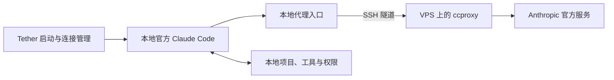

# 项目定位：个人 Claude Code 自托管接入与运维工具

更新日期：2026-10-23。本文描述当前产品方向；已实现功能以 [README](../README.zh-CN.md)、[兼容性表](COMPATIBILITY.md)和对应测试报告为准。

## 一句话定位

**Claude Tether 帮助个人在本地使用官方 Claude Code，通过自己的 VPS 接入官方模型服务，并管理这条连接的配置、版本、诊断和维护。**

底层包含请求转发。产品价值在于把官方客户端、自有 VPS 和 ccproxy 组合成容易启动、检查和维护的个人工具。ccproxy 负责请求层代理；Tether 优先围绕它做接入与运维，不另写一套模型网关或 Claude 交互界面。

## 用户目标与优先级

1. **账号持续可用性优先。** 减少不必要的认证干预和异常请求，审计凭据、日志与网络路径，明确故障和限流行为。没有已知方法能保证账号永不被封；请求伪装也不作为降低封号率的已证实手段。
2. **保留原生使用体验。** 在本地项目启动官方 CLI，由其管理聊天、`/model`、文件、Shell、权限、项目配置和扩展。具体版本与网关组合必须实际验收，不能提前宣称全功能兼容。
3. **降低个人维护成本。** 多个自有设备使用明确的配置与连接入口，安装、健康检查、升级和回退有可复现步骤。

关于 ccproxy 能修改哪些信息、哪些内容仍会传到上游，以及账号风险的证据边界，见[固定版本调研](NATIVE-CLAUDE-RESEARCH.md)。

## 目标架构与职责

| 组件              | 职责                                                 | 当前状态                                                   |
| ----------------- | ---------------------------------------------------- | ---------------------------------------------------------- |
| 官方 Claude Code  | 本地 Agent 循环、界面、工具执行、权限与会话          | 官方能力；与本项目新链路的组合待验收                       |
| ccproxy           | VPS 请求转发与协议适配                               | 已调研；本项目尚未集成或部署                               |
| Tether 客户端     | 管理 SSH 连接、启动参数、隔离配置和清晰的连接状态    | 原生 CLI 启动入口待实现；已有工具桥的 SSH 实现可供复用评估 |
| Tether 部署与维护 | 固定版本、私有配置、健康检查、最小化日志、升级与回退 | 新路线待实现；已有原型具备部分工程基础                     |

新路线下，主 Agent 位于本地，取代原方案“主进程必须在 VPS”的产品约束。文件与命令留在本地、个人官方订阅、个人自有设备使用的目标继续保留。原生会话由官方 CLI 管理，不把旧 relay 的 session 或操作 journal 强行接入新路径。

## 已实现原型与新主线

当前 `tether connect` 仍连接远端 Agent 的工具桥。其专用客户端、MCP 本地工具、设备凭据、持久操作记录和显式恢复已通过受控 VPS → WSL 验收。它不是启动本地官方 `claude` 的入口，也不能通过更换一个 URL 就接到 ccproxy。

保留该原型的源码、运行说明和测试证据，维护必要的正确性修复；完整自建 TUI、复刻原生斜杠命令、hooks/skills 兼容层不再作为主线产品目标。现有部署不会因文档调整而自动迁移或停用。[原型架构](ARCHITECTURE.md)和[原型快速开始](QUICKSTART.md)继续可用。

当前没有 ccproxy 安装器、原生 CLI 启动命令或新链路验收结果。新功能的退出条件见[路线图](ROADMAP.md)，通过后再提供正式使用命令。

## 范围与交付

第一阶段面向个人 Linux/WSL 环境与自有 VPS，优先验证单一官方上游和用户本人的官方登录流程。Windows 原生/macOS 的可用性需要各自测试。应用层代理可以接触请求内容与认证头；诊断应优先使用合成请求，并验证正式日志不保存凭据和对话正文。

交付重点是可重复的安装/连接配置、版本锁定、状态诊断、故障处理与原生客户端兼容性报告。通过连接测试不代表通过长期运行验收，更不代表降低或消除账号封禁风险。

通用 VPN、商业多租户平台、账号池、订阅转售、集中分发订阅凭据和“隐身/防封保证”不属于该产品范围。也不以跨供应商模型路由作为首个版本的目标。

## 对开源仓库的影响

继续使用 `claude-tether` 仓库与名称。文档明确区分产品目标、当前可执行原型和研究结论；不把 ccproxy 上游能力标成已经交付的 Tether 功能。ccproxy 是优先适配的外部组件，当前提交没有将其源码、二进制或依赖并入包内。未来集成需记录固定版本和上游许可要求。
